# Connect CRM no Kubernetes (Minikube)

## Aplicação
Connect CRM: backend em Spring Boot (Java 21, Maven) com banco PostgreSQL.
A aplicação roda com 2 réplicas e se conecta ao banco pelo Service `banco-service`.

## Passo a passo

### 1. Subir o Minikube
```
minikube start --memory=3500mb --cpus=2
kubectl get nodes
```

### 2. Banco de dados
```
kubectl apply -f k8s/banco-secret.yaml
kubectl apply -f k8s/banco-deployment.yaml
kubectl apply -f k8s/banco-service.yaml
```

### 3. Aplicação
```
cd backend
.\mvnw.cmd package -DskipTests
docker build -t crm:1.1 .
minikube image load crm:1.1
cd ..
kubectl apply -f k8s/app-secret.yaml
kubectl apply -f k8s/app-deployment.yaml
kubectl apply -f k8s/app-service.yaml
kubectl get pods
```

### 4. Acessar a aplicação
```
minikube service app-service --url
```

### 5. Observabilidade (Helm, namespace `monitoring`)
Prometheus (métricas), Loki + Promtail (logs), Tempo (traces) e Grafana (painéis).
Os comandos estão em [k8s/observability/install.md](k8s/observability/install.md).
```
kubectl port-forward -n monitoring svc/grafana 3000:80
```
Grafana em http://localhost:3000.

Data sources configurados no Grafana:
- Prometheus: `http://prometheus-server`
- Loki: `http://loki:3100`
- Tempo: `http://tempo:3200`

## Evidências

### Cluster Minikube iniciado
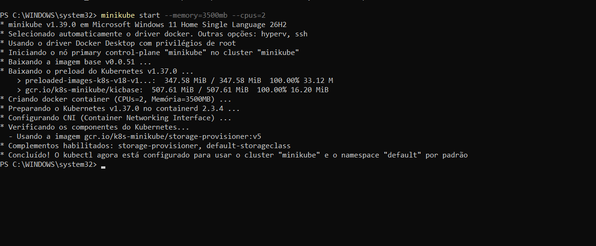

### Nó pronto (`kubectl get nodes`)
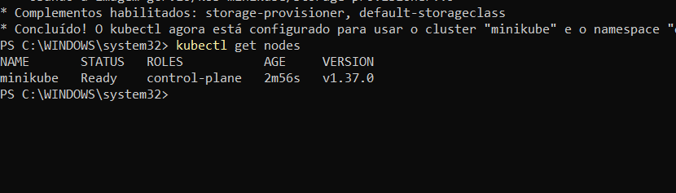

### Banco de dados: manifestos aplicados
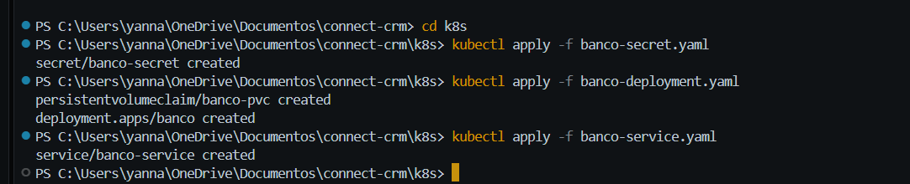

### Banco de dados rodando
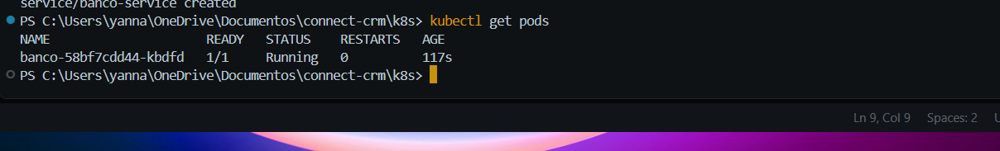

### Imagem do CRM carregada no Minikube
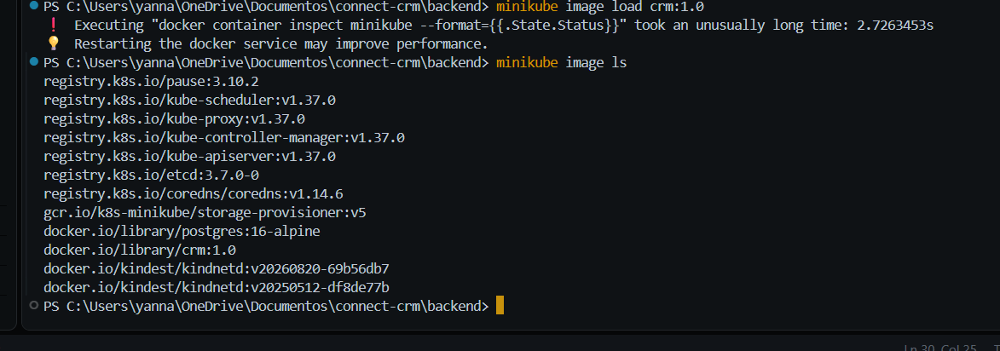

### Aplicação com 2 réplicas ativas + banco (`kubectl get pods`)
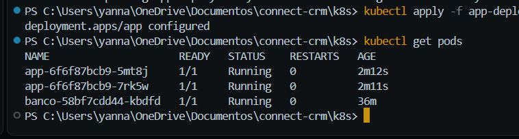

### URL do Service exposta pelo Minikube
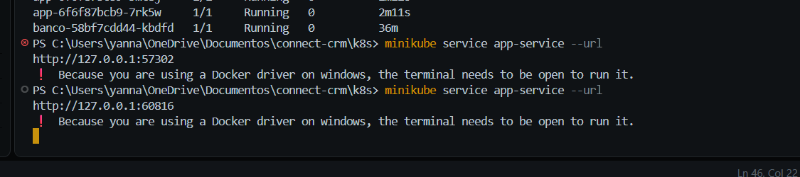

### Aplicação respondendo no navegador
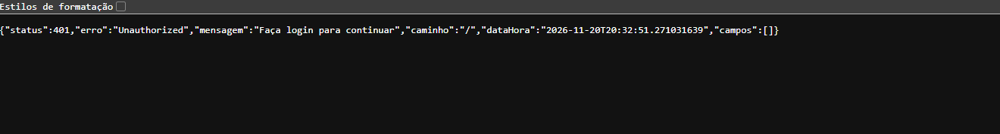

### Tabelas criadas pela aplicação no PostgreSQL
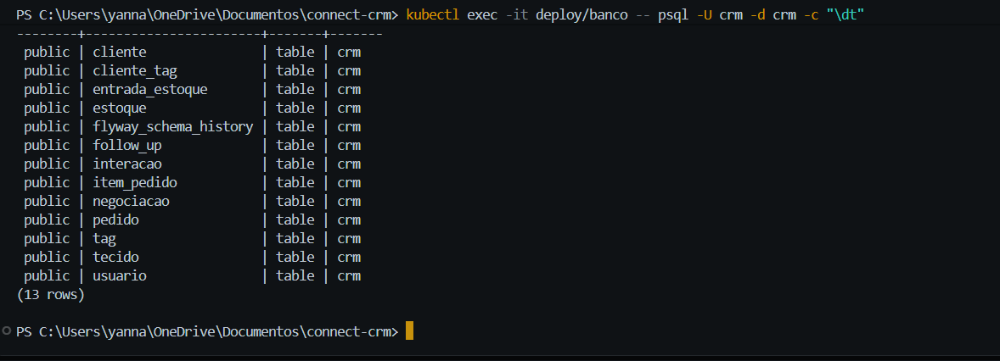

### Login funcionando (consulta ao banco, retorna token)
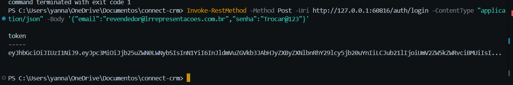

### Helm: Prometheus e Grafana instalados
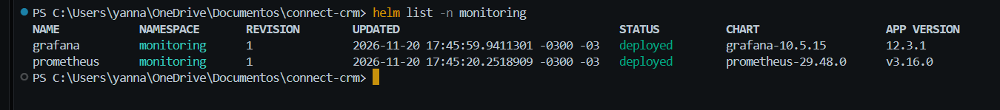

### Stack de observabilidade rodando (Grafana, Loki, Promtail, Tempo, Prometheus)
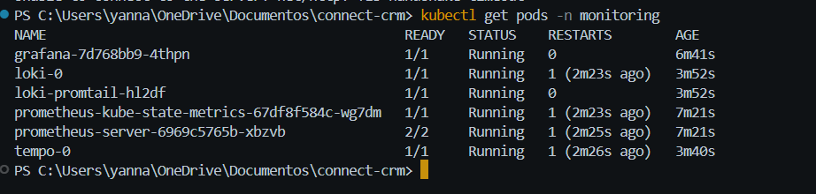

### Grafana: métricas do Prometheus (pods ativos)
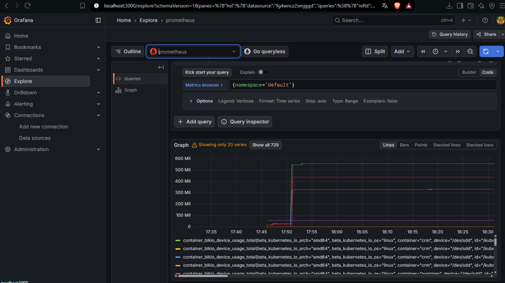

### Grafana: logs do Loki (aplicação CRM)
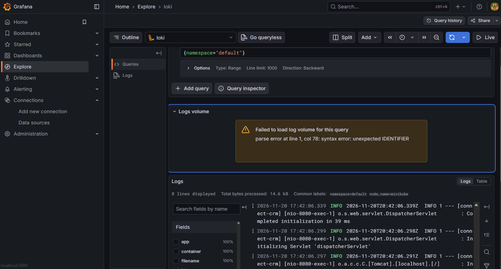

### Grafana: data sources (Prometheus, Loki e Tempo)
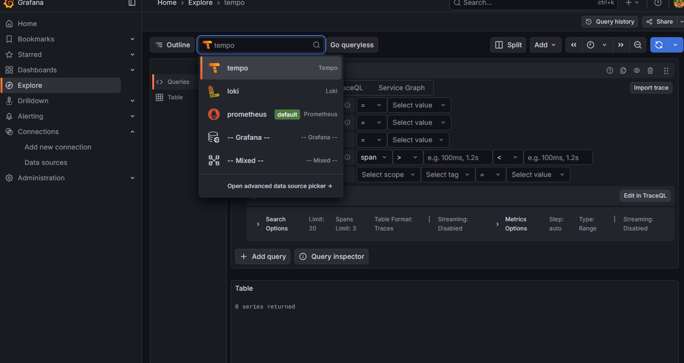

## Observações

- O teste de conexão ("Save & test") do Loki no Grafana exibe aviso por diferença de versão entre o Grafana e o Loki, mas as consultas funcionam normalmente no Explore, como mostram os logs acima.
- Traces: o Tempo está instalado e conectado ao Grafana como data source. O envio de traces pela aplicação (agente OpenTelemetry no CRM) ficou como próximo passo.
- Este arquivo se chama `README-k8s.md` para não sobrescrever o README original do projeto.