# Manual do usuário — Connect CRM

Guia de uso do Connect CRM para a **LR Representações**. Explica cada tela do sistema e como fazer as tarefas do dia a dia: encontrar clientes, chamar no WhatsApp, acompanhar negociações, cadastrar tecidos e registrar a chegada de estoque.

> [!NOTE]
> **Situação deste manual:** os prints foram feitos nas telas da `develop` em 11/11/2026, que ainda usam **dados de exemplo** (ainda não estão ligadas à API). As seções marcadas com 🚧 descrevem telas ou partes de tela que ainda estão em desenvolvimento, e as seções de telas já prontas dizem o que ainda falta nelas. No code freeze (23/11), os prints e essas seções devem ser atualizados com a versão 1.0.0 — veja [Como atualizar este manual](#como-atualizar-este-manual).

## Sumário

1. [Acesso ao sistema](#1-acesso-ao-sistema)
2. [Menu lateral](#2-menu-lateral)
3. [Dashboard](#3-dashboard)
4. [Clientes](#4-clientes)
5. [Funil de negociações](#5-funil-de-negociações)
6. [Catálogo de tecidos](#6-catálogo-de-tecidos)
7. [Estoque](#7-estoque)
8. [Novo pedido](#8-novo-pedido)
9. [Histórico de vendas](#9-histórico-de-vendas)
10. [Dúvidas frequentes](#10-dúvidas-frequentes)

---

## 1. Acesso ao sistema

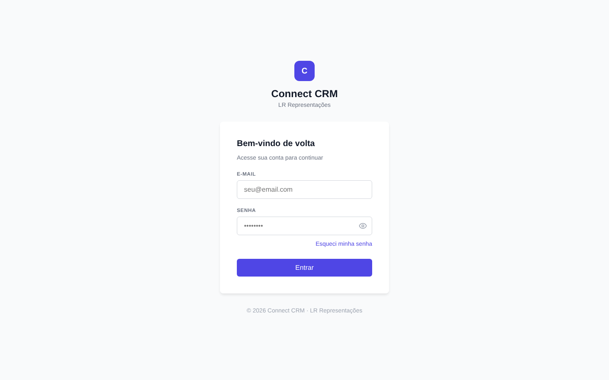

**Para entrar:**

1. Informe o **e-mail** e a **senha** de acesso.
2. Clique no ícone de olho (👁) se quiser conferir a senha digitada.
3. Clique em **Entrar**. O sistema abre o Dashboard.

**Esqueci minha senha:** clique no link abaixo do campo de senha. Por segurança, o sistema sempre responde *"Se o e-mail estiver cadastrado, enviaremos o link"*, sem dizer se o e-mail existe ou não.

**Para sair:** use o botão **Sair**, no canto inferior do menu lateral.

> O sistema tem **um único usuário** (o revendedor). Não existe cadastro de outros usuários nem perfis de acesso nesta versão.

---

## 2. Menu lateral

O menu fica sempre à esquerda e leva a todas as telas. A tela aberta aparece destacada.

| Item | Para que serve |
|---|---|
| **Dashboard** | resumo do dia: vendas do mês, negociações, pendências e estoque baixo |
| **Clientes** | lista de clientes, busca, filtro por tag e WhatsApp |
| **Funil** | negociações em andamento, organizadas por etapa |
| **Catálogo** | tecidos vendidos, com composição, medidas e preço por metro |
| **Estoque** | metragem disponível de cada tecido em cada cor e registro de chegada |
| **Novo Pedido** | registrar uma venda |
| **Histórico de Vendas** | pedidos feitos, com as ações de marcar como pago e cancelar |

---

## 3. Dashboard

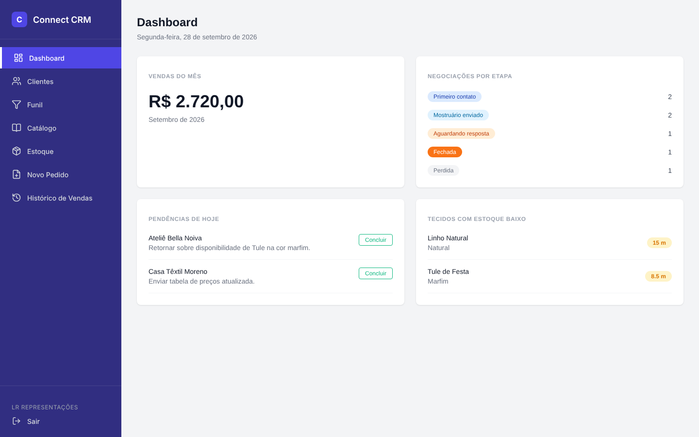

É a primeira tela depois do login. Mostra quatro quadros:

| Quadro | O que mostra |
|---|---|
| **Vendas do mês** | soma dos pedidos do mês atual. Pedidos **cancelados não entram** na soma. |
| **Negociações por etapa** | quantas negociações existem em cada etapa do funil. |
| **Pendências de hoje** | follow-ups (próximas ações) com data para hoje ou atrasados, só de clientes ativos. Clique em **Concluir** quando a ação for feita. |
| **Tecidos com estoque baixo** | tecido + cor com **menos de 20 metros** disponíveis. |

**Dica:** comece o dia pelas *Pendências de hoje* e confira o *Estoque baixo* antes de oferecer um tecido.

---

## 4. Clientes

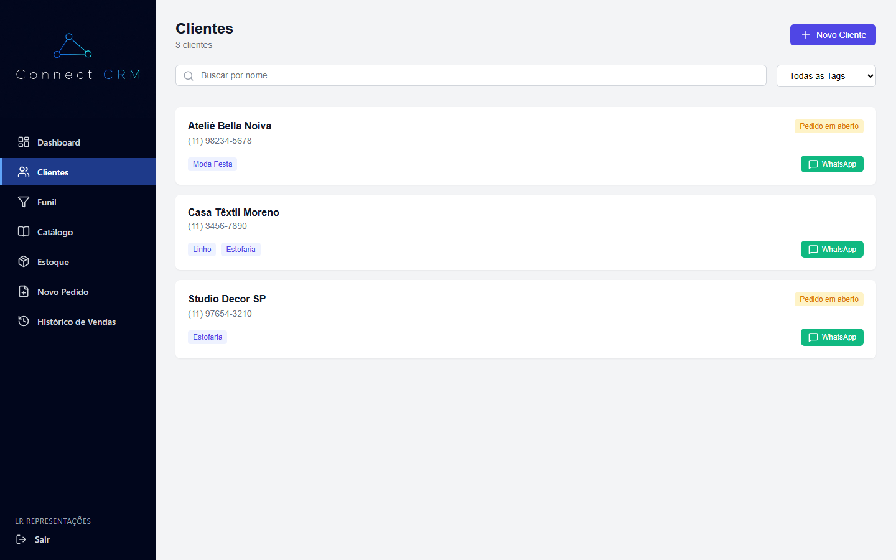

Lista das lojas, ateliês e confecções atendidos. Cada cartão mostra o **nome**, o **telefone**, as **tags** de interesse e, quando houver, a tarja **Pedido em aberto** (o cliente tem um pedido ainda não pago).

### 4.1 Buscar um cliente

Digite parte do nome no campo **Buscar por nome...**. A lista é filtrada enquanto você digita.

### 4.2 Filtrar por tag

As tags indicam o que o cliente costuma comprar (ex.: *Moda Festa*, *Linho*, *Estofaria*).

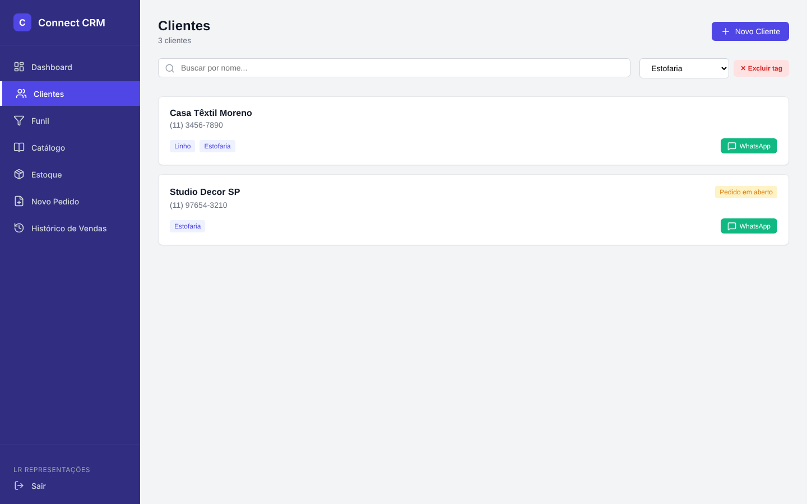

1. No seletor ao lado da busca, escolha a tag.
2. A lista mostra só os clientes com essa tag.
3. Para ver todos de novo, escolha **Todas as Tags**.

### 4.3 Chamar no WhatsApp

Clique no botão verde **WhatsApp** do cartão. O WhatsApp abre numa nova aba com uma mensagem pronta:

- **Sem filtro de tag:** *"Olá <cliente>, como podemos ajudar hoje?"*
- **Com uma tag selecionada:** *"Olá <cliente>, acabou de chegar um novo mostruário de <tag>, posso agendar uma visita?"*

Você pode editar a mensagem no WhatsApp antes de enviar. O sistema **não envia nada sozinho**: ele só abre a conversa.

> **Uso prático:** chegou mostruário de linho? Filtre por **Linho** e chame cada cliente da lista com a mensagem já pronta.

### 4.4 Excluir uma tag

Com uma tag selecionada no filtro, aparece o botão **✕ Excluir tag**. Ao excluir, a tag é removida de todos os clientes que a usam. O sistema pede confirmação antes.

### 4.5 Novo cliente 🚧

O botão **Novo Cliente** abrirá o cadastro com nome, telefone, e-mail, CPF/CNPJ, cidade/UF e tags. As tags podem ser criadas na hora: se já existir uma tag com o mesmo nome (mesmo com maiúsculas diferentes), o sistema reaproveita a existente.

### 4.6 Ficha do cliente

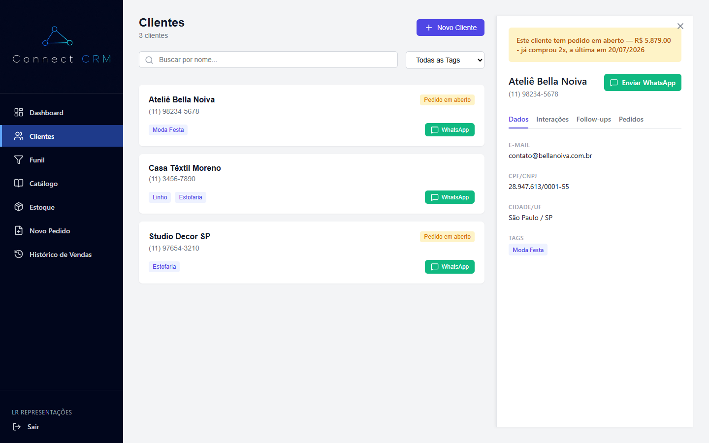

Clique no cartão de um cliente para abrir a ficha ao lado da lista. Ela mostra o nome, o telefone, o botão **Enviar WhatsApp** (abre a conversa com *"Olá <cliente>, tudo bem?"*) e quatro abas:

| Aba | Conteúdo |
|---|---|
| **Dados** | e-mail, CPF/CNPJ, cidade/UF e tags |
| **Interações** 🚧 | conversas já feitas (WhatsApp, ligação, visita...) — botão **+ Registrar interação** |
| **Follow-ups** 🚧 | próximas ações com data — botão **+ Novo Follow-up** |
| **Pedidos** 🚧 | pedidos do cliente |

Se o cliente tiver pedido em aberto, um aviso amarelo aparece no topo da ficha. Para fechar a ficha, clique no **X** no canto superior.

> **O que ainda falta:** a aba **Dados** já funciona. As abas **Interações**, **Follow-ups** e **Pedidos** ainda aparecem vazias, e os botões **+ Registrar interação** e **+ Novo Follow-up** ainda não abrem o cadastro.

### 4.7 Clientes desativados

Clientes **não são apagados**: são desativados, e o histórico é preservado. Um cliente com pedido em aberto ou negociação em andamento não pode ser desativado até isso ser resolvido. Clientes desativados podem ser reativados.

---

## 5. Funil de negociações

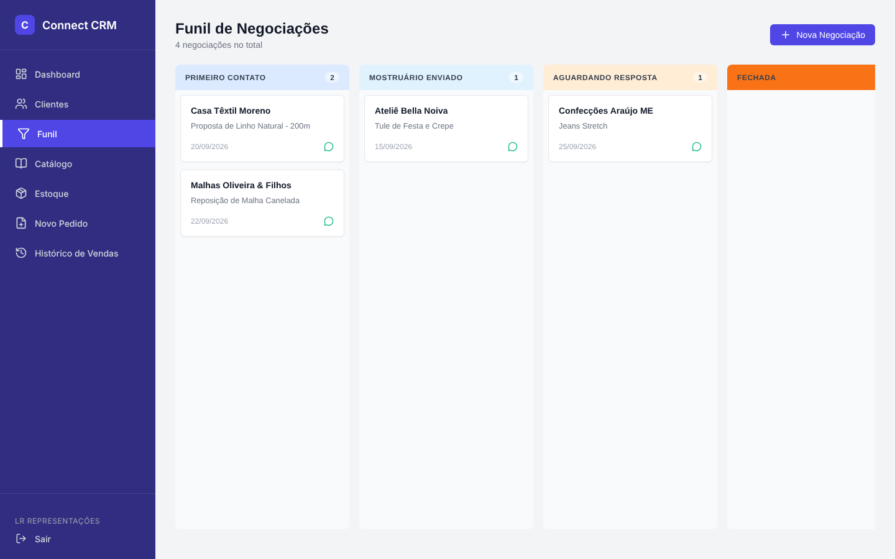

Mostra as negociações como cartões, em colunas que representam as etapas da venda:

| Etapa | Significado |
|---|---|
| **Primeiro contato** | primeira conversa com o cliente sobre uma compra |
| **Mostruário enviado** | o cliente recebeu as amostras |
| **Aguardando resposta** | o revendedor espera a decisão do cliente |
| **Fechada** | o cliente comprou |
| **Perdida** | o cliente não comprou |

Cada cartão mostra o cliente, a descrição e a data. O ícone verde abre o WhatsApp do cliente.

**Mover uma negociação:** clique no cartão, arraste até a coluna da nova etapa e solte. Se a tela for estreita, role para o lado para ver as últimas colunas.

**Ao soltar em Fechada:** o sistema pergunta *"Criar pedido para o cliente?"*. Respondendo **OK**, abre o Novo Pedido já com o cliente da negociação.

---

## 6. Catálogo de tecidos

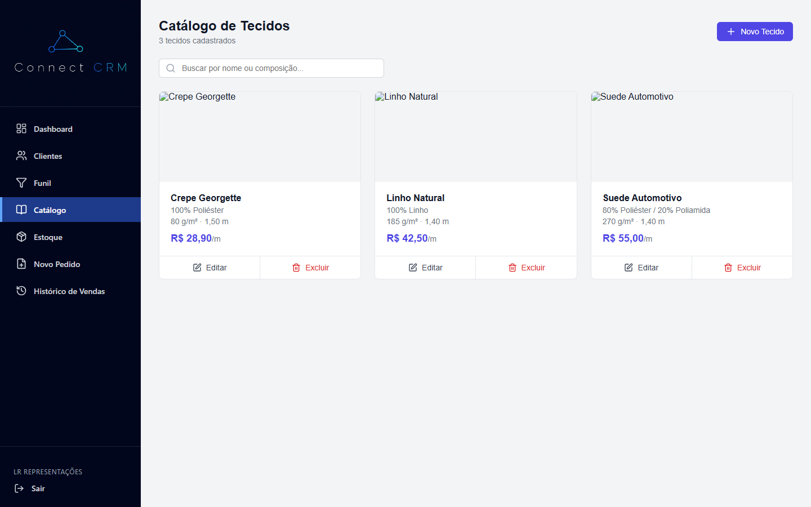

Lista os tecidos vendidos, com foto, nome, composição, gramatura, largura e **preço por metro**. Use a busca para encontrar pelo nome ou pela composição (ex.: *linho*, *poliéster*).

> A cor **não** fica no catálogo: o mesmo tecido pode ter várias cores, e cada cor é controlada no **Estoque**.

### 6.1 Cadastrar um tecido

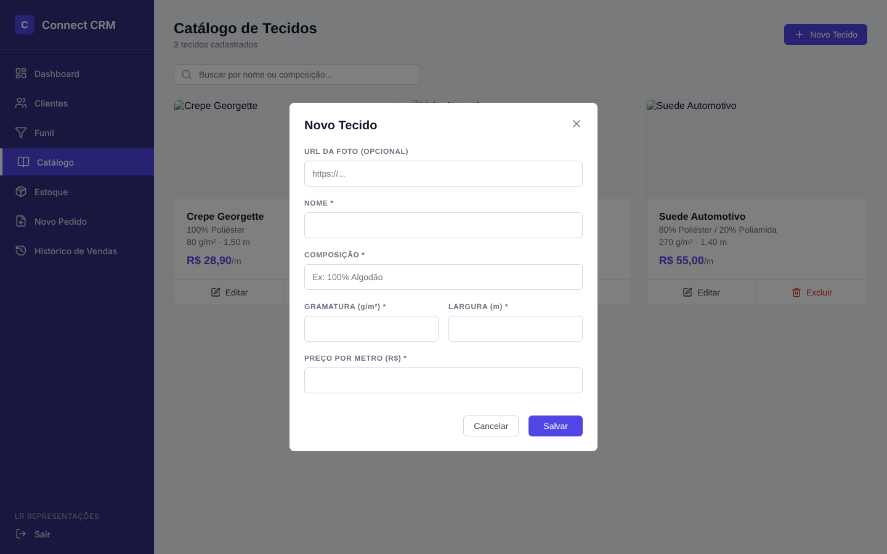

1. Clique em **Novo Tecido**.
2. Preencha os campos. A foto é opcional (informe o endereço de uma imagem na internet).
3. Clique em **Salvar**.

| Campo | Exemplo |
|---|---|
| Nome | Linho Natural |
| Composição | 100% Linho |
| Gramatura (g/m²) | 185 |
| Largura (m) | 1,40 |
| Preço por metro (R$) | 42,50 |

### 6.2 Editar e excluir

Os botões **Editar** e **Excluir** ficam em cada cartão. Assim como os clientes, tecidos **não são apagados**: são desativados e podem ser reativados. O estoque de um tecido desativado não aparece na tela Estoque e não pode ser vendido.

---

## 7. Estoque

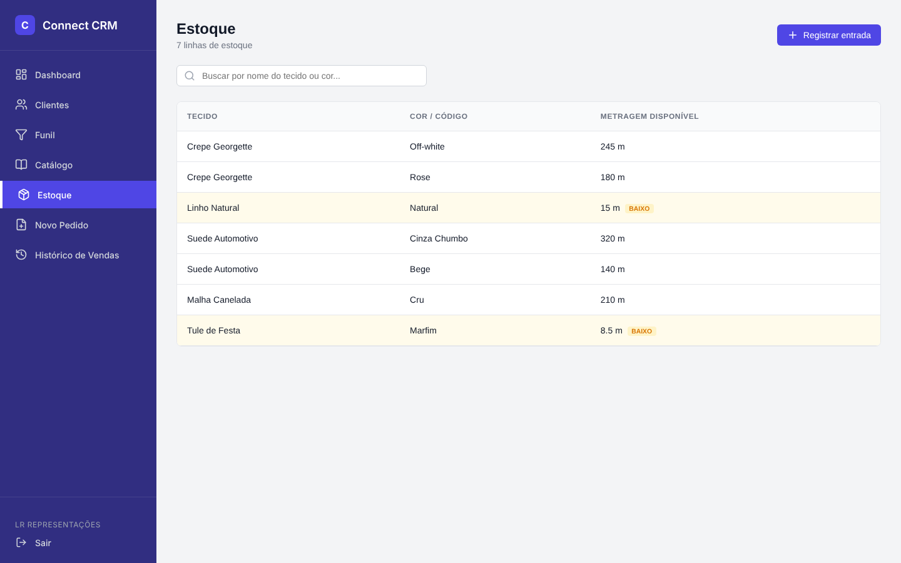

Mostra a **metragem disponível** de cada tecido em cada cor. Todo o estoque é controlado em **metros** (não em peças ou rolos).

- Linhas em amarelo com a etiqueta **BAIXO** têm menos de 20 metros.
- Use a busca para filtrar pelo nome do tecido ou pela cor.

### 7.1 Registrar a chegada de tecido

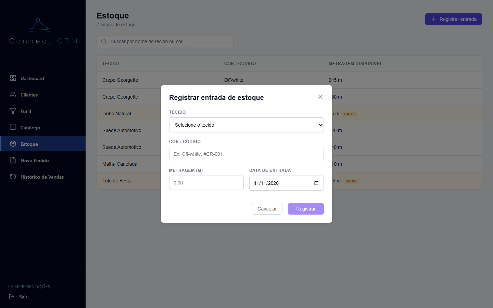

1. Clique em **Registrar entrada**.
2. Escolha o **tecido**.
3. Informe a **cor/código** (ex.: *Off-white*, *#CR-001*).
4. Informe a **metragem** que chegou e a **data de entrada** (já vem com a data de hoje).
5. Clique em **Registrar**.

Se o tecido já tiver estoque nessa cor, a metragem é **somada** ao saldo. Se for uma cor nova, o sistema cria a linha. Cada entrada fica guardada no histórico.

---

## 8. Novo pedido

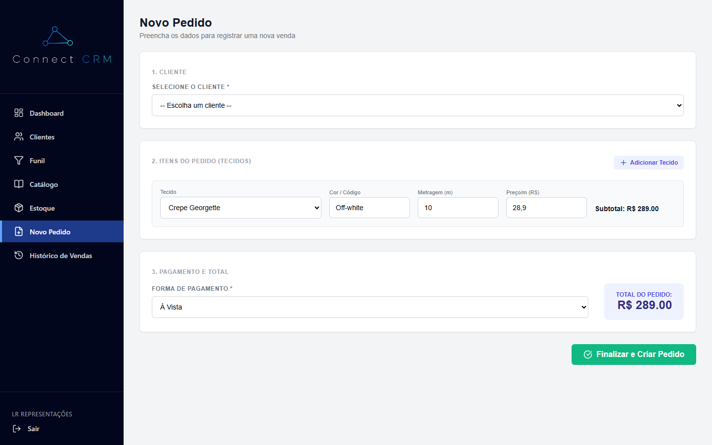

Tela de registro de venda, em três partes:

1. **Cliente:** escolha o cliente na lista. Se você veio do Funil (negociação solta em **Fechada**), o cliente já vem escolhido.
2. **Itens do pedido:** para cada tecido, escolha o **tecido**, confira a **cor/código** e informe a **metragem**. O preço por metro vem do catálogo e o **subtotal** é calculado na hora. Use **+ Adicionar Tecido** para incluir outro item e a lixeira para tirar um item.
3. **Pagamento e total:** escolha a forma de pagamento (**À Vista**, **Cartão**, **Boleto** ou **Cheque**) e confira o **total do pedido**, que é a soma dos subtotais.

Clique em **Finalizar e Criar Pedido**. O pedido começa como **em aberto** (não pago) e o sistema abre o Histórico de Vendas.

Regras da venda:

- O pedido é de um cliente ativo, com um ou mais itens (tecido + cor + metragem).
- Só é possível vender o que existe em estoque. Se faltar, o sistema avisa, por exemplo: *"Estoque insuficiente: Linho Bege 102 tem 18 m"*.
- O mesmo tecido + cor aparece uma vez por pedido: adicionar de novo soma a metragem.
- O total é calculado pelo sistema (metragem × preço por metro). O preço fica gravado no pedido, então mudar o preço no catálogo não altera pedidos antigos.
- Ao confirmar, a metragem sai do estoque.

> **O que ainda falta:** a tela usa dados de exemplo e ainda não grava o pedido. O aviso de estoque insuficiente, a soma do tecido + cor repetido e a baixa no estoque passam a valer quando a tela for ligada à API de pedidos.

---

## 9. Histórico de vendas

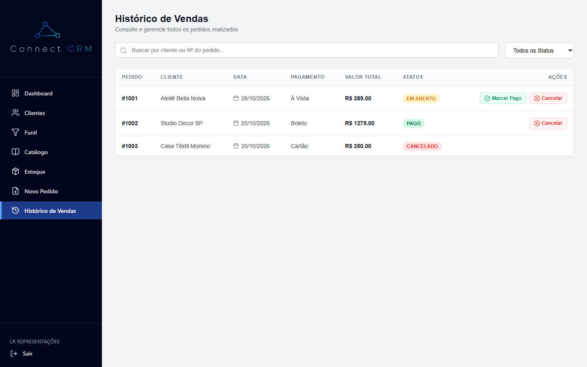

Lista os pedidos com número, cliente, data, forma de pagamento, valor total e situação (**EM ABERTO**, **PAGO** ou **CANCELADO**).

- **Buscar:** digite o nome do cliente ou o número do pedido.
- **Filtrar pela situação:** use o seletor ao lado da busca (**Todos os Status**, **Em Aberto**, **Pago** ou **Cancelado**).
- **Marcar Pago:** aparece nos pedidos em aberto e encerra a pendência do pedido.
- **Cancelar:** aparece nos pedidos que ainda não foram cancelados. O sistema pede confirmação, devolve a metragem ao estoque e muda a situação para **CANCELADO**. O cancelamento é definitivo, e o pedido continua registrado.

Pedidos cancelados não entram nas vendas do mês nem no total vendido.

> **O que ainda falta:** a tela usa dados de exemplo. Ainda não há o filtro por **período** nem o **total vendido** no período (sem os cancelados), que fazem parte do histórico de vendas da versão 1.0.0.

---

## 10. Dúvidas frequentes

**O WhatsApp não abriu.**
Confira se o navegador bloqueou a nova aba (ícone na barra de endereço) e permita pop-ups para o Connect CRM.

**Um cliente sumiu da lista.**
Confira se não há texto na busca ou uma tag selecionada no filtro. Se o cliente foi desativado, ele só aparece na opção de mostrar inativos.

**Excluí uma tag sem querer.**
Os clientes continuam cadastrados; só o vínculo com a tag foi removido. Crie a tag de novo e adicione aos clientes.

**Por que não consigo vender um tecido?**
O tecido pode estar desativado no catálogo ou sem metragem suficiente naquela cor.

**Não lembro a senha.**
Use **Esqueci minha senha** na tela de login.

---

## Como atualizar este manual

Para a equipe, no code freeze ou quando uma tela mudar:

1. Suba o sistema seguindo o [README](../../README.md), de preferência com o perfil `dev` (dados de teste).
2. Abra o navegador em **1440 × 900** (tamanho de referência do layout).
3. Refaça os prints das telas que mudaram, com os mesmos nomes de arquivo em `docs/manual/img/` (`01-login.png`, `02-dashboard.png`...). Para as telas novas, siga a numeração (`13-...png`).
4. Tire o 🚧 e a seção de *Situação deste manual* quando todas as telas estiverem prontas.
5. **Não** mostre senhas, e-mails ou telefones reais nos prints.
